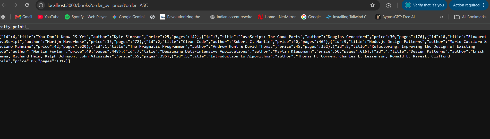
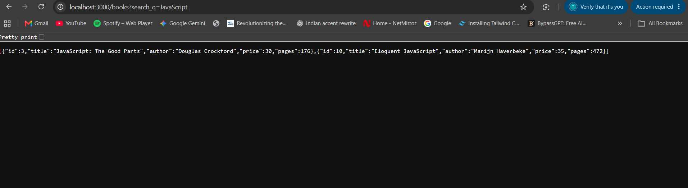
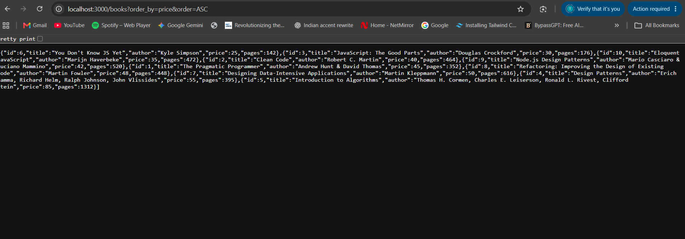
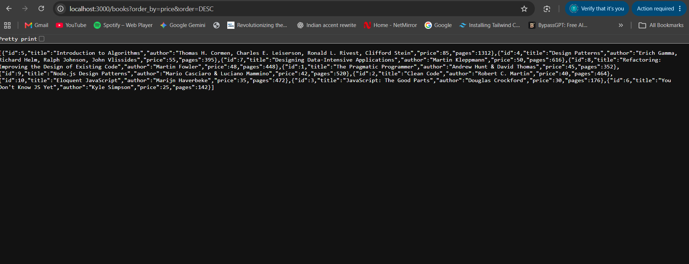
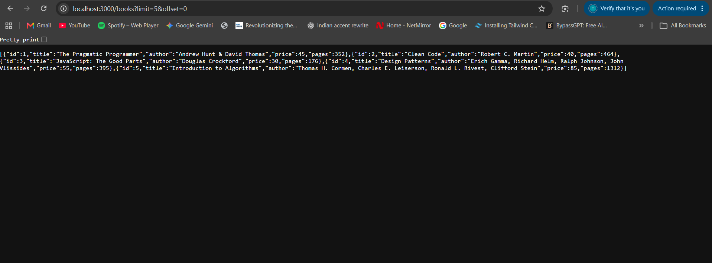

# BDF Lab 3: REST API, Query Parameters, Validation and Debugging

---

## 1. Student & Course Information

| Field | Detail |
|---|---|
| **Student Name** | Tarendra Reddy |
| **Registration Number** | 252U1R9157 |
| **Course** | Backend Development Fundamentals |
| **Academic Year & Term** | Year II, Term II |
| **University** | Aurora Deemed University |
| **Faculty Instructor** | Joel Prashanth D |
| **Lab Number** | 03 |
| **Lab Title** | REST API, Query Parameters, Validation and Debugging |

---

## 2. Lab Objective

The primary objective of **Lab 3** is to extend the foundation established in Lab 2 by transforming basic CRUD endpoints into a secure, robust, and feature-rich RESTful API. 

Key competencies demonstrated in this lab include:
1. **REST API Architecture:** Structuring Express.js routes and separating database configuration (`database.js`) from application routing (`server.js`).
2. **SQLite Database Operations:** Interacting with an embedded SQLite database using `sqlite3` and the promise-based `sqlite` library with `async/await`.
3. **Advanced Query Parameters:**
   - **Partial Search:** Filtering records using SQL `LIKE` with wildcards (`%`).
   - **Dynamic Sorting:** Ordering results by specified columns (`ORDER BY`) in `ASC` or `DESC` order with allowlist protection against SQL injection.
   - **Pagination:** Implementing limit and offset techniques (`LIMIT ? OFFSET ?`) to serve data in manageable pages.
   - **Price Range Filtering:** Querying numeric ranges using minimum (`min_price`) and maximum (`max_price`) thresholds.
4. **Input Validation & Sanitization:** Validating request bodies and query parameters, rejecting negative numbers, enforcing data types, and preventing invalid states (e.g., `min_price > max_price`).
5. **HTTP Status Code Precision:** Returning standard status codes (`200 OK`, `201 Created`, `400 Bad Request`, `404 Not Found`, `500 Internal Server Error`).
6. **Backend Debugging:** Diagnosing and resolving real-world errors such as port conflicts (`EADDRINUSE`), broken module paths, schema typos, and missing `await` statements.

---

## 3. Technology Stack

- **Runtime Environment:** [Node.js](https://nodejs.org/) (v18+ / v20+ / v24+)
- **Web Framework:** [Express.js](https://expressjs.com/) (`express` v4.21+)
- **Database Engine:** [SQLite](https://www.sqlite.org/) (Embedded file-based relational database)
- **Database Drivers & Wrappers:**
  - `sqlite3` (v5.1+) — Core SQLite C++ binding for Node.js
  - `sqlite` (v5.1+) — Promise wrapper enabling native `async/await` syntax
- **Development Tooling:**
  - `nodemon` — Automatic server reloading upon file modification
  - [Postman](https://www.postman.com/) — API design and endpoint verification
  - [Visual Studio Code](https://code.visualstudio.com/) — Source code editor

*Design Constraint: Pure CommonJS syntax (`require` / `module.exports`) with minimal dependencies for student-friendly practical exam comprehension.*

---

## 4. Project Structure

```text
lab-03/
│
├── server.js                        # Express app, validation middleware, and 5 REST endpoints
├── database.js                      # Database connection, table creation, and seed logic
├── database.db                      # SQLite binary database file containing the book table
├── package.json                     # Project manifest, dependencies, and npm run scripts
├── .gitignore                       # Excludes node_modules/ and temporary files
├── README.md                        # Comprehensive project documentation and testing guide
│
├── screenshots/                     # Test output evidence (25 Postman & terminal screenshots)
│   ├── 01-get-all-books.png
│   ├── 02-search-books.png
│   ├── 03-sort-ascending.png
│   ├── 04-sort-descending.png
│   ├── 05-pagination.png
│   ├── 06-pagination-next-page.png
│   ├── 07-min-price-filter.png
│   ├── 08-max-price-filter.png
│   ├── 09-price-range.png
│   ├── 10-combined-query.png
│   ├── 11-get-book-by-id.png
│   ├── 12-book-not-found.png
│   ├── 13-add-book.png
│   ├── 14-missing-title.png
│   ├── 15-missing-author.png
│   ├── 16-invalid-price.png
│   ├── 17-update-book.png
│   ├── 18-update-invalid-id.png
│   ├── 19-delete-book.png
│   ├── 20-delete-invalid-id.png
│   ├── 21-sqlite-database.png
│   ├── 22-port-conflict.png
│   ├── 23-import-error.png
│   ├── 24-table-error.png
│   └── 25-missing-await.png
│
└── debugging/
    └── debugging-exercises.md       # In-depth guide to 4 core backend debugging scenarios
```

---

## 5. Database Schema & Seed Data

The database file is `database.db`. The table is defined as follows:

```sql
CREATE TABLE IF NOT EXISTS book (
    id INTEGER PRIMARY KEY AUTOINCREMENT,
    title TEXT NOT NULL,
    author TEXT NOT NULL,
    price INTEGER NOT NULL,
    pages INTEGER NOT NULL
);
```

### Initial Seed Records (10 Books)

| ID | Title | Author | Price ($) | Pages |
|:--:|---|---|:---:|:---:|
| 1 | The Pragmatic Programmer | Andrew Hunt & David Thomas | 45 | 352 |
| 2 | Clean Code | Robert C. Martin | 40 | 464 |
| 3 | JavaScript: The Good Parts | Douglas Crockford | 30 | 176 |
| 4 | Design Patterns | Erich Gamma, Richard Helm, Ralph Johnson, John Vlissides | 55 | 395 |
| 5 | Introduction to Algorithms | Thomas H. Cormen, Charles E. Leiserson, Ronald L. Rivest, Clifford Stein | 85 | 1312 |
| 6 | You Don't Know JS Yet | Kyle Simpson | 25 | 142 |
| 7 | Designing Data-Intensive Applications | Martin Kleppmann | 50 | 616 |
| 8 | Refactoring: Improving the Design of Existing Code | Martin Fowler | 48 | 448 |
| 9 | Node.js Design Patterns | Mario Casciaro & Luciano Mammino | 42 | 520 |
| 10 | Eloquent JavaScript | Marijn Haverbeke | 35 | 472 |

> **Note on Idempotence:** The startup function in `database.js` inspects `SELECT COUNT(*) AS count FROM book;`. If records exist, seeding is safely skipped so initial records are preserved without duplication upon every server restart.

---

## 6. Installation & Execution Guide

### Step 1: Open the Project Directory
Open your terminal or command prompt and navigate to `lab-03`:
```bash
cd "lab-03"
```

### Step 2: Install Node Dependencies
Run the standard package manager installation:
```bash
npm install
```
This installs `express`, `sqlite`, `sqlite3`, and the developer dependency `nodemon`.

### Step 3: Start the Application Server

#### Option A: Development Mode (Auto-restart with Nodemon)
```bash
npm start
```

#### Option B: Standard Production Mode
```bash
npm run serve
```
or:
```bash
node server.js
```

### Step 4: Verify Console Output
When the server successfully connects to SQLite and begins listening, you will observe:
```text
Database initialized and seeded with 10 records.
Server running on port 3000
```

---

## 7. REST API Endpoints Summary

| Method | Endpoint | Description | Expected Status Codes |
|---|---|---|:---:|
| `GET` | `/books` | Retrieve books with filtering, searching, sorting & pagination | `200 OK`, `400 Bad Request` |
| `GET` | `/books/:bookId` | Retrieve a single book by primary key `id` | `200 OK`, `400 Bad Request`, `404 Not Found` |
| `POST` | `/books` | Create a new book record | `201 Created`, `400 Bad Request` |
| `PUT` | `/books/:bookId` | Update an existing book's details | `200 OK`, `400 Bad Request`, `404 Not Found` |
| `DELETE` | `/books/:bookId` | Remove a book record by `id` | `200 OK`, `400 Bad Request`, `404 Not Found` |

---

## 8. Query Parameters Detailed Guide (API 1: `GET /books`)

The `GET /books` endpoint accepts up to 7 optional query parameters:

| Parameter | Type | Default | Description | Validation Rule |
|---|---|---|---|---|
| `search_q` | String | `""` | Partial text match against `title` using SQL `LIKE` | Any string; converted to `'%<search_q>%'` |
| `order_by` | String | `'id'` | Column to sort by | Must be in allowlist: `['id', 'title', 'author', 'price', 'pages']` |
| `order` | String | `'ASC'` | Sort direction | Must be either `'ASC'` or `'DESC'` (case-insensitive) |
| `limit` | Integer | `10` | Maximum number of records to return | Must be an integer $\ge 0$ |
| `offset` | Integer | `0` | Number of records to skip (for pagination) | Must be an integer $\ge 0$ |
| `min_price`| Number | `null` | Lower bound filter for `price` | Must be a numeric value $\ge 0$ |
| `max_price`| Number | `null` | Upper bound filter for `price` | Must be a numeric value $\ge 0$; $\text{min\_price} \le \text{max\_price}$ |

### SQL Parameterization & Security (Defense against SQL Injection)

SQL values such as search patterns, limits, offsets, and prices are bound using positional `?` placeholders:
```sql
SELECT * FROM book WHERE title LIKE ? AND price >= ? AND price <= ? ORDER BY price ASC LIMIT ? OFFSET ?;
```
For dynamic identifiers like table columns and sort directions (which cannot be parameterized using `?`), an **Allowlist Validation** approach is used:
```javascript
const allowedColumns = ['id', 'title', 'author', 'price', 'pages'];
if (!allowedColumns.includes(normalizedOrderBy)) {
  return response.status(400).send({ error: 'Invalid order_by column' });
}
```
This guarantees that malicious SQL snippets (e.g. `order_by=price; DROP TABLE book;--`) are completely rejected with `400 Bad Request` before reaching the database engine.

---

## 9. HTTP Status Codes Reference

| Code | Label | Usage in Lab 3 |
|:---:|---|---|
| **200** | **OK** | Standard success response for `GET` (records fetched), `PUT` (record updated), and `DELETE` (record removed). |
| **201** | **Created** | Successful resource creation in `POST /books`. |
| **400** | **Bad Request** | Client error: missing required body fields, non-numeric prices/pages, invalid query parameters, negative limit/offset, or `min_price > max_price`. |
| **404** | **Not Found** | Requested resource was not found in the database (e.g., `bookId` does not exist in `GET`, `PUT`, or `DELETE`). |
| **500** | **Internal Server Error** | Unexpected server-side or database exception. Handled gracefully with `{ "error": "Internal Server Error" }`. |

### Standard JSON Response Conventions

**Success Response Format:**
```json
{
  "message": "Book Added Successfully"
}
```

**Error Response Format:**
```json
{
  "error": "Book Not Found"
}
```

---

## 10. Comprehensive Postman Testing Guide (20 Test Cases)

Base URL: `http://localhost:3000`

### Test 1: Get All Books
- **Method:** `GET`
- **URL:** `http://localhost:3000/books`
- **Expected Status:** `200 OK`
- **Expected Result:** Array of all 10 books in default order (`id` ASC).
```json
[
  { "id": 1, "title": "The Pragmatic Programmer", "author": "Andrew Hunt & David Thomas", "price": 45, "pages": 352 },
  ...
  { "id": 10, "title": "Eloquent JavaScript", "author": "Marijn Haverbeke", "price": 35, "pages": 472 }
]
```

### Test 2: Search Books by Title
- **Method:** `GET`
- **URL:** `http://localhost:3000/books?search_q=JavaScript`
- **Expected Status:** `200 OK`
- **Expected Result:** Exactly 2 books matching the keyword:
  1. Book 3: *JavaScript: The Good Parts*
  2. Book 10: *Eloquent JavaScript*

### Test 3: Sort by Price Ascending
- **Method:** `GET`
- **URL:** `http://localhost:3000/books?order_by=price&order=ASC`
- **Expected Status:** `200 OK`
- **Expected Result:** 10 books sorted in ascending order of price:
  - Lowest price first: Book 6 (*You Don't Know JS Yet*, $25)
  - Highest price last: Book 5 (*Introduction to Algorithms*, $85)

### Test 4: Sort by Price Descending
- **Method:** `GET`
- **URL:** `http://localhost:3000/books?order_by=price&order=DESC`
- **Expected Status:** `200 OK`
- **Expected Result:** 10 books sorted in descending order of price:
  - Highest price first: Book 5 (*Introduction to Algorithms*, $85)
  - Lowest price last: Book 6 (*You Don't Know JS Yet*, $25)

### Test 5: Pagination (Page 1)
- **Method:** `GET`
- **URL:** `http://localhost:3000/books?limit=5&offset=0`
- **Expected Status:** `200 OK`
- **Expected Result:** First 5 books (IDs 1 through 5).

### Test 6: Pagination (Page 2)
- **Method:** `GET`
- **URL:** `http://localhost:3000/books?limit=5&offset=5`
- **Expected Status:** `200 OK`
- **Expected Result:** Next 5 books (IDs 6 through 10).

### Test 7: Minimum Price Filter
- **Method:** `GET`
- **URL:** `http://localhost:3000/books?min_price=50`
- **Expected Status:** `200 OK`
- **Expected Result:** Books with `price >= 50` (3 books):
  - Book 4: *Design Patterns* ($55)
  - Book 5: *Introduction to Algorithms* ($85)
  - Book 7: *Designing Data-Intensive Applications* ($50)

### Test 8: Maximum Price Filter
- **Method:** `GET`
- **URL:** `http://localhost:3000/books?max_price=35`
- **Expected Status:** `200 OK`
- **Expected Result:** Books with `price <= 35` (3 books):
  - Book 3: *JavaScript: The Good Parts* ($30)
  - Book 6: *You Don't Know JS Yet* ($25)
  - Book 10: *Eloquent JavaScript* ($35)

### Test 9: Price Range Filter
- **Method:** `GET`
- **URL:** `http://localhost:3000/books?min_price=40&max_price=50`
- **Expected Status:** `200 OK`
- **Expected Result:** Books with prices between $40 and $50 inclusive (5 books):
  - Book 1: *The Pragmatic Programmer* ($45)
  - Book 2: *Clean Code* ($40)
  - Book 7: *Designing Data-Intensive Applications* ($50)
  - Book 8: *Refactoring: Improving the Design of Existing Code* ($48)
  - Book 9: *Node.js Design Patterns* ($42)

### Test 10: Combined Query Parameters
- **Method:** `GET`
- **URL:** `http://localhost:3000/books?search_q=JavaScript&order_by=price&order=ASC&limit=5&offset=0&min_price=25&max_price=50`
- **Expected Status:** `200 OK`
- **Expected Result:** Matching titles containing "JavaScript", price between 25 and 50, sorted by price ASC:
  1. Book 3: *JavaScript: The Good Parts* ($30)
  2. Book 10: *Eloquent JavaScript* ($35)

### Test 11: Get Individual Book by ID
- **Method:** `GET`
- **URL:** `http://localhost:3000/books/1`
- **Expected Status:** `200 OK`
- **Expected Response:**
```json
{
  "id": 1,
  "title": "The Pragmatic Programmer",
  "author": "Andrew Hunt & David Thomas",
  "price": 45,
  "pages": 352
}
```

### Test 12: Book Not Found
- **Method:** `GET`
- **URL:** `http://localhost:3000/books/999`
- **Expected Status:** `404 Not Found`
- **Expected Response:**
```json
{
  "error": "Book Not Found"
}
```

### Test 13: Add a New Book
- **Method:** `POST`
- **URL:** `http://localhost:3000/books`
- **Headers:** `Content-Type: application/json`
- **Request Body:**
```json
{
  "title": "Python Programming",
  "author": "John",
  "price": 60,
  "pages": 350
}
```
- **Expected Status:** `201 Created`
- **Expected Response:**
```json
{
  "message": "Book Added Successfully"
}
```

### Test 14: Validation Failure – Missing Title
- **Method:** `POST`
- **URL:** `http://localhost:3000/books`
- **Headers:** `Content-Type: application/json`
- **Request Body:**
```json
{
  "author": "John",
  "price": 60,
  "pages": 350
}
```
- **Expected Status:** `400 Bad Request`
- **Expected Response:**
```json
{
  "error": "Title is required and cannot be empty"
}
```

### Test 15: Validation Failure – Missing Author
- **Method:** `POST`
- **URL:** `http://localhost:3000/books`
- **Headers:** `Content-Type: application/json`
- **Request Body:**
```json
{
  "title": "Python Programming",
  "price": 60,
  "pages": 350
}
```
- **Expected Status:** `400 Bad Request`
- **Expected Response:**
```json
{
  "error": "Author is required and cannot be empty"
}
```

### Test 16: Validation Failure – Invalid Price
- **Method:** `POST`
- **URL:** `http://localhost:3000/books`
- **Headers:** `Content-Type: application/json`
- **Request Body:**
```json
{
  "title": "Python Programming",
  "author": "John",
  "price": "invalid",
  "pages": 350
}
```
- **Expected Status:** `400 Bad Request`
- **Expected Response:**
```json
{
  "error": "Price must be a valid non-negative number"
}
```

### Test 17: Update Book
- **Method:** `PUT`
- **URL:** `http://localhost:3000/books/1`
- **Headers:** `Content-Type: application/json`
- **Request Body:**
```json
{
  "title": "The Pragmatic Programmer (20th Anniversary Edition)",
  "author": "Andrew Hunt & David Thomas",
  "price": 50,
  "pages": 352
}
```
- **Expected Status:** `200 OK`
- **Expected Response:**
```json
{
  "message": "Book Details Updated"
}
```

### Test 18: Update Non-Existent Book ID
- **Method:** `PUT`
- **URL:** `http://localhost:3000/books/999`
- **Headers:** `Content-Type: application/json`
- **Request Body:**
```json
{
  "title": "Ghost Book",
  "author": "Unknown",
  "price": 20,
  "pages": 100
}
```
- **Expected Status:** `404 Not Found`
- **Expected Response:**
```json
{
  "error": "Book Not Found"
}
```

### Test 19: Delete Book
- **Method:** `DELETE`
- **URL:** `http://localhost:3000/books/11`
- **Expected Status:** `200 OK`
- **Expected Response:**
```json
{
  "message": "Book Deleted Successfully"
}
```

### Test 20: Delete Non-Existent Book ID
- **Method:** `DELETE`
- **URL:** `http://localhost:3000/books/999`
- **Expected Status:** `404 Not Found`
- **Expected Response:**
```json
{
  "error": "Book Not Found"
}
```

---

## 11. Screenshots Gallery

Place the captured screenshots in the `screenshots/` directory using the filenames listed below:

| # | Filename | Description | Preview Reference |
|:---:|---|---|:---:|
| 01 | `01-get-all-books.png` | `GET /books` returning all 10 books |  |
| 02 | `02-search-books.png` | `GET /books?search_q=JavaScript` |  |
| 03 | `03-sort-ascending.png` | `GET /books?order_by=price&order=ASC` |  |
| 04 | `04-sort-descending.png` | `GET /books?order_by=price&order=DESC` |  |
| 05 | `05-pagination.png` | `GET /books?limit=5&offset=0` |  |
| 06 | `06-pagination-next-page.png`| `GET /books?limit=5&offset=5` |  |
| 07 | `07-min-price-filter.png` | `GET /books?min_price=50` |  |
| 08 | `08-max-price-filter.png` | `GET /books?max_price=35` |  |
| 09 | `09-price-range.png` | `GET /books?min_price=40&max_price=50` |  |
| 10 | `10-combined-query.png` | `GET /books` with all parameters combined |  |
| 11 | `11-get-book-by-id.png` | `GET /books/1` returning individual book |  |
| 12 | `12-book-not-found.png` | `GET /books/999` returning 404 |  |
| 13 | `13-add-book.png` | `POST /books` creating a new book (201) |  |
| 14 | `14-missing-title.png` | `POST /books` validation error (400) |  |
| 15 | `15-missing-author.png` | `POST /books` missing author (400) |  |
| 16 | `16-invalid-price.png` | `POST /books` invalid price (400) |  |
| 17 | `17-update-book.png` | `PUT /books/1` updating book details (200) |  |
| 18 | `18-update-invalid-id.png` | `PUT /books/999` updating non-existent book (404) |  |
| 19 | `19-delete-book.png` | `DELETE /books/11` removing book (200) |  |
| 20 | `20-delete-invalid-id.png` | `DELETE /books/999` non-existent book (404) |  |
| 21 | `21-sqlite-database.png` | Terminal `sqlite3 database.db` query verification |  |
| 22 | `22-port-conflict.png` | Terminal showing `EADDRINUSE` port conflict |  |
| 23 | `23-import-error.png` | Terminal showing `MODULE_NOT_FOUND` error |  |
| 24 | `24-table-error.png` | Postman / terminal `no such table` error |  |
| 25 | `25-missing-await.png` | Pending promise returning `{}` without `await` |  |

---

## 12. Debugging Exercises Summary

Detailed documentation for each debugging exercise is available in [`debugging/debugging-exercises.md`](debugging/debugging-exercises.md).

### 1. `EADDRINUSE` (Port Conflict)
- **Cause:** Port `3000` is already in use by another instance or application.
- **Solution:** 
  1. Terminate conflicting PID: `taskkill /F /PID <PID>` (Windows) or `kill -9 <PID>` (Linux/Mac).
  2. Use dynamic port configuration: `const port = process.env.PORT || 3000`.

### 2. `MODULE_NOT_FOUND` (Wrong Module Path)
- **Cause:** Using `require('database')` instead of relative `./database` or misspelling folder names.
- **Solution:** Always prefix local project files with `./` or `../`: `require('./database')`.

### 3. `SQLITE_ERROR: no such table` (Table Name Typo)
- **Cause:** Executing queries on `books` when the schema explicitly defined `book`.
- **Solution:** Ensure SQL queries strictly match the table name: `SELECT * FROM book`.

### 4. Missing `await` (Asynchronous Database Promise)
- **Cause:** Forgetting `await` before asynchronous calls (`db.all()`, `db.get()`, `db.run()`).
- **Symptom:** Express serializes the pending Promise into an empty object `{}`.
- **Solution:** Always prefix database calls with `await` inside an `async (request, response)` route handler.

---

## 13. Practical Problems Faced & Solutions

### 1. String Types for Query Parameters
- **Problem:** Express parses all query parameters from URLs as strings (e.g., `request.query.limit` returns `"5"`, not `5`). When passing them into SQL calculations or validations, direct strict equality checks (`===`) can fail.
- **Solution:** Explicitly convert query parameters using `Number()` or `parseInt(..., 10)` and validate using `!Number.isInteger(...)` or `isNaN(...)`.

### 2. Preventing SQL Injection with `ORDER BY`
- **Problem:** SQLite does not allow column names in `ORDER BY ? ?` to be parameterized with `?`. Directly concatenating user input (`ORDER BY ${order_by}`) leaves the application open to SQL injection.
- **Solution:** Implemented an **allowlist check**:
  ```javascript
  const allowedColumns = ['id', 'title', 'author', 'price', 'pages']
  if (!allowedColumns.includes(normalizedOrderBy)) {
    return response.status(400).send({ error: 'Invalid order_by column' })
  }
  ```

### 3. Duplicate Seed Records on Server Restart
- **Problem:** If seed insertion queries run on every `server.js` startup, the table accumulates duplicate entries every time Nodemon restarts.
- **Solution:** Performed a count check before inserting seed data:
  ```javascript
  const rowCount = await db.get('SELECT COUNT(*) AS count FROM book;')
  if (rowCount.count === 0) {
    // Run seed INSERT queries
  }
  ```

### 4. Cross-Field Query Validation (`min_price` vs `max_price`)
- **Problem:** A user could pass `min_price=100` and `max_price=20`, producing an impossible search condition without any helpful error message.
- **Solution:** Added a cross-validation rule:
  ```javascript
  if (parsedMinPrice !== null && parsedMaxPrice !== null && parsedMinPrice > parsedMaxPrice) {
    return response.status(400).send({ error: 'min_price cannot exceed max_price' })
  }
  ```

---

## 14. Viva & Practical Examination Questions

1. **What is the difference between `request.params` and `request.query`?**
   - `request.params` captures route path variables (e.g. `/books/:bookId` $\rightarrow$ `request.params.bookId`).
   - `request.query` captures URL search query strings after the `?` delimiter (e.g. `/books?limit=5` $\rightarrow$ `request.query.limit`).

2. **Why do we use parameterized queries with `?` placeholders?**
   - They separate SQL code from untrusted user input, ensuring the database engine treats input strictly as literal values rather than executable code, thereby preventing SQL injection attacks.

3. **Why do we return HTTP `201` instead of `200` for `POST /books`?**
   - HTTP `201 Created` indicates that the request was successful and a new resource was created on the server.

4. **What does `LIMIT` and `OFFSET` achieve in SQL?**
   - `LIMIT` specifies the maximum number of rows to return, and `OFFSET` specifies the number of rows to skip, providing the foundation for database-level pagination.

5. **Why must database operations in Node.js be asynchronous?**
   - Disk and database I/O take time. Using non-blocking `async/await` ensures the single-threaded Node.js event loop remains responsive and can handle other concurrent user requests without freezing.

